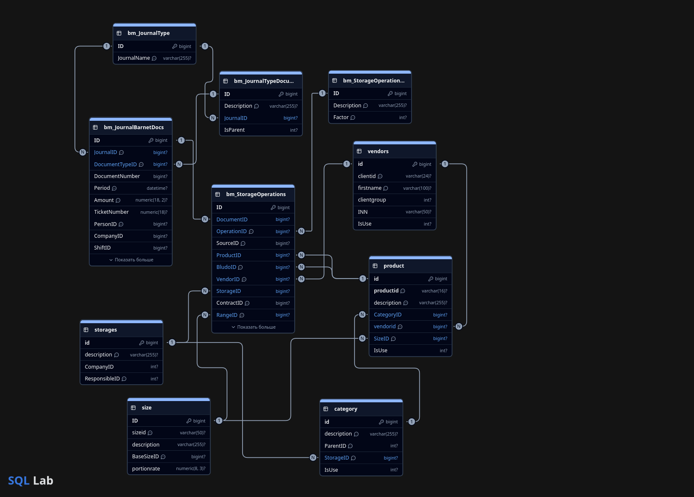
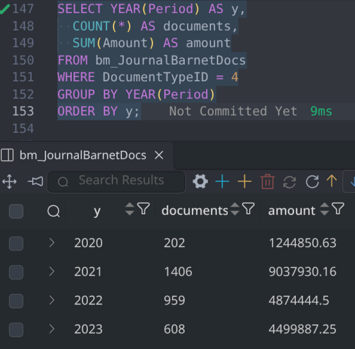
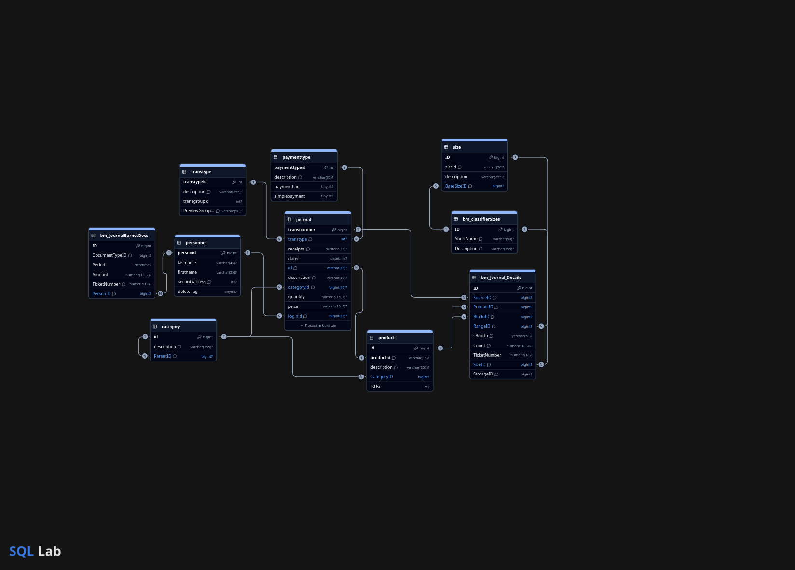
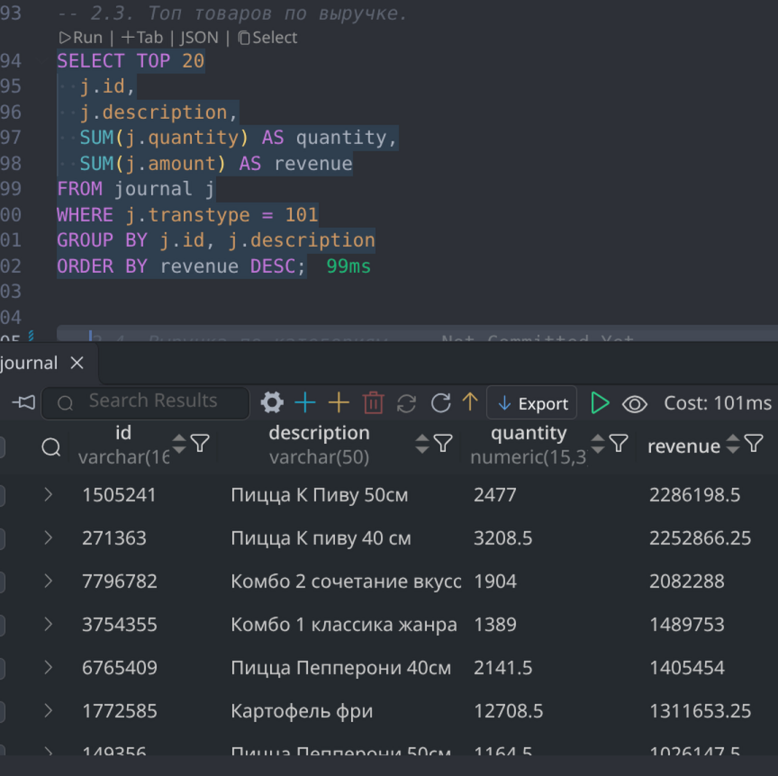
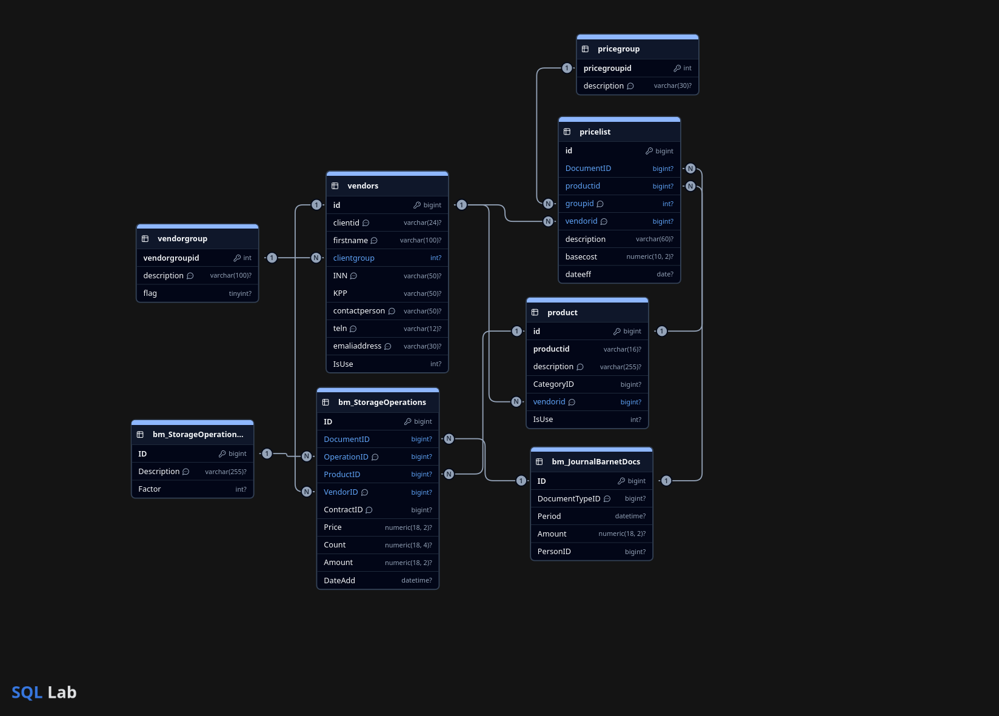
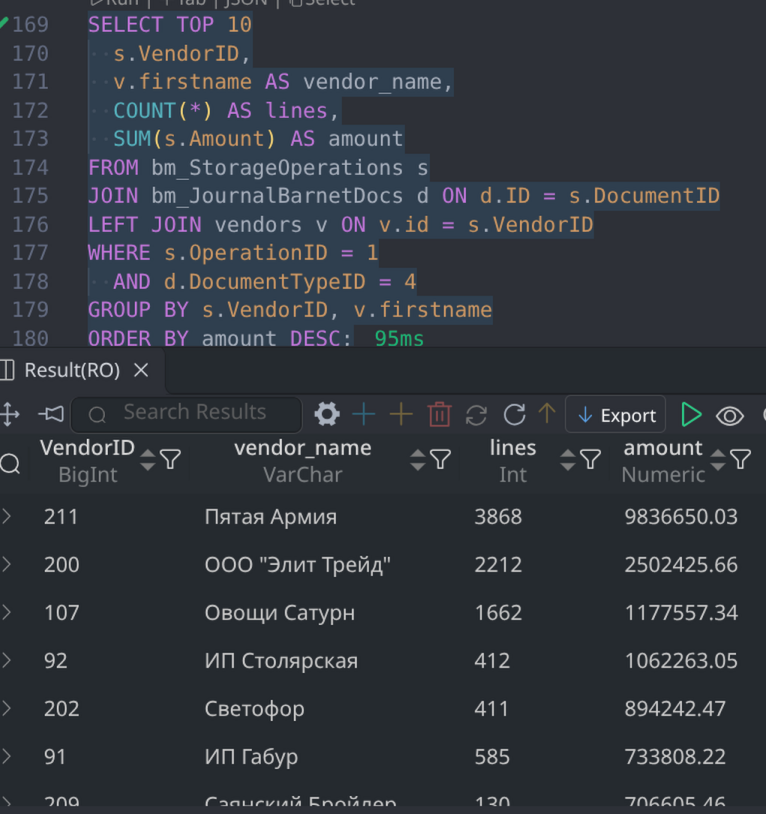
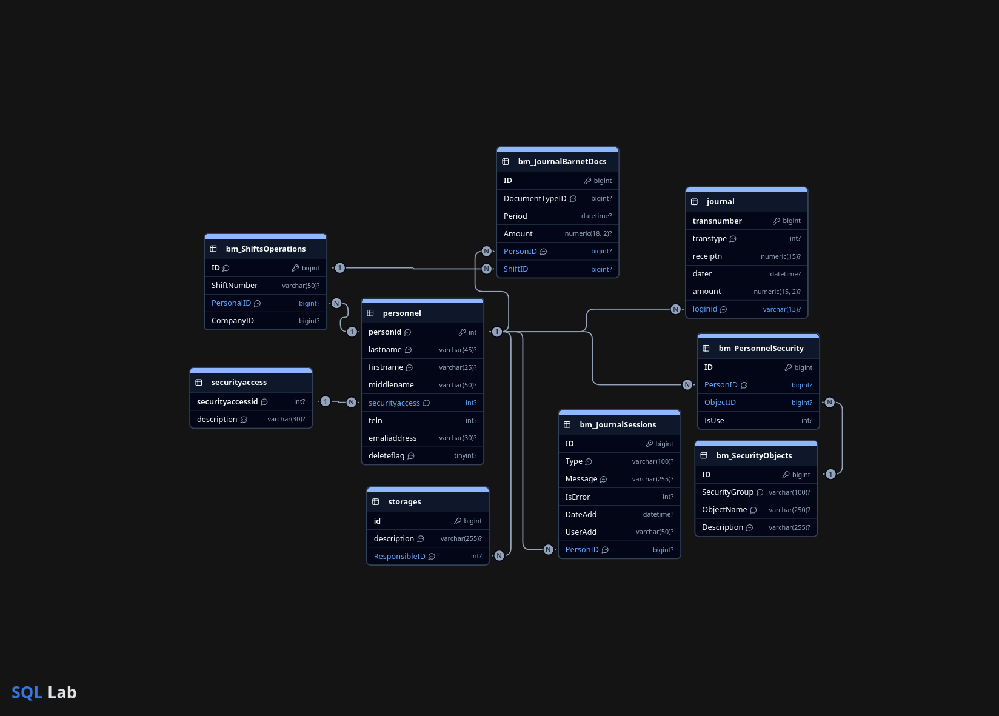
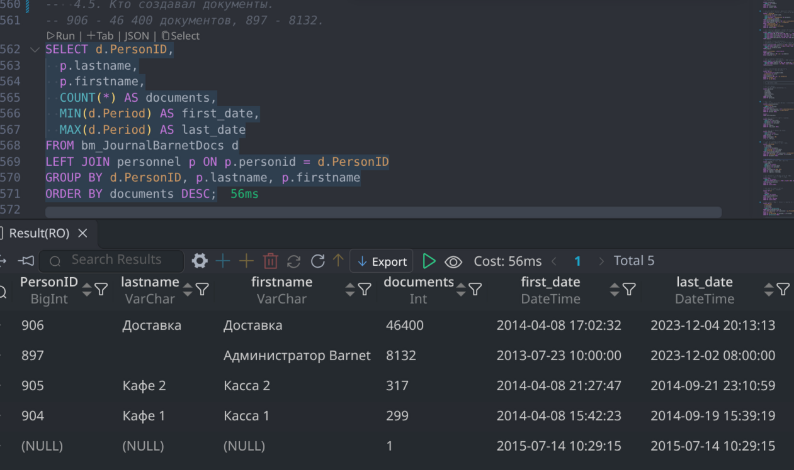
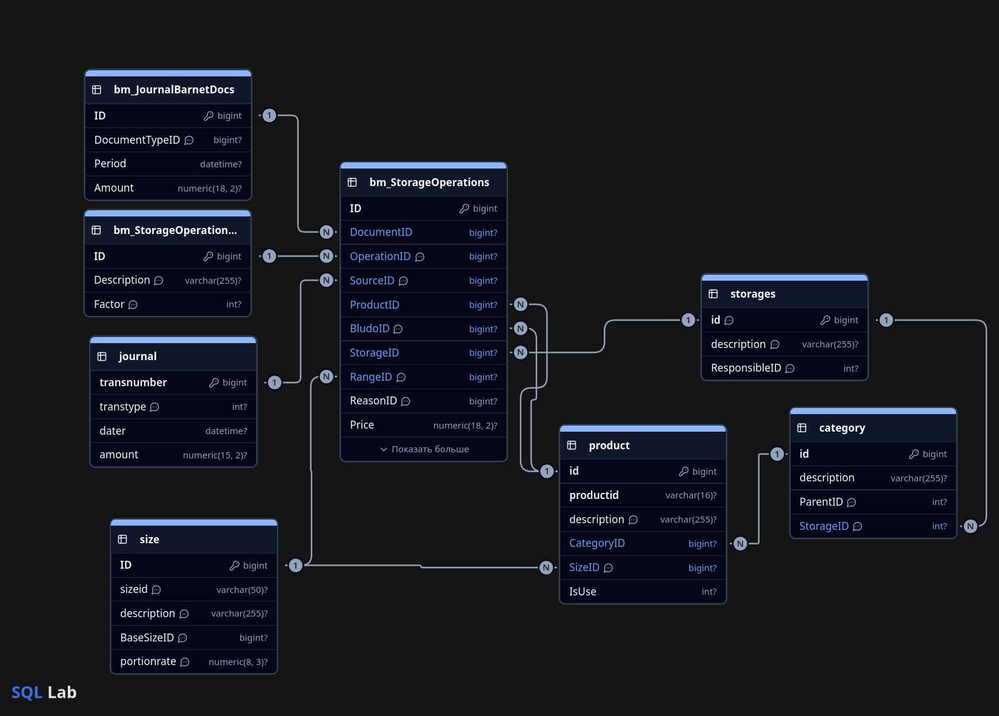
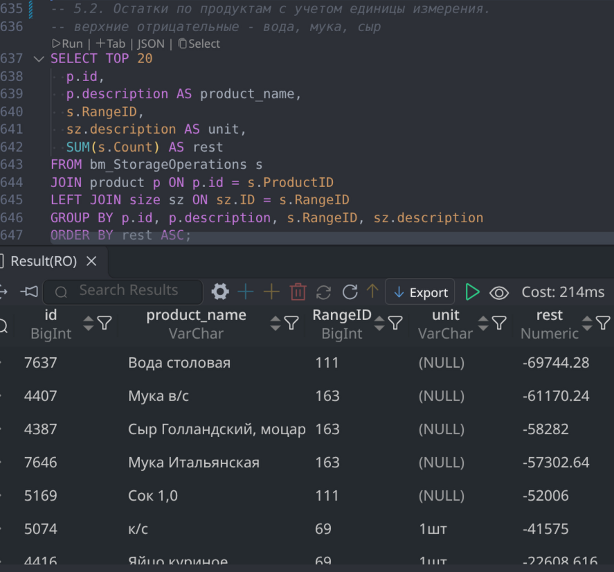

# Front - анализ базы данных

Все запросы лежат в [scripts.sql](./scripts.sql).

## Общие таблицы

### bm_JournalBarnetDocs - заголовки документов

| Колонка | Назначение | Пример | Связь |
|---|---|---|---|
| ID | номер документа | 465989 | PK |
| DocumentTypeID | вид документа | 6 (товарный чек), 4 (поступление) | bm_JournalTypeDocuments.ID |
| Period | дата документа | 2023-12-04 20:13:13 | - |
| Amount | сумма документа | 688.50 | - |
| PersonID | кто создал документ | 906 | personnel.personid (без FK) |

### bm_StorageOperations - строки складских операций

| Колонка | Назначение | Пример | Связь |
|---|---|---|---|
| ID | номер строки | 4780421 | PK |
| DocumentID | документ | 388235 | bm_JournalBarnetDocs.ID |
| OperationID | вид операции | 1 (поступление), 2 (списание) | bm_StorageOperationsType.ID |
| ProductID | продукт | 4368 | product.id |
| VendorID | поставщик | 200 | vendors.id (без FK) |
| RangeID | единица измерения | 42 (кг) | size.ID (без FK) |
| Count | количество со знаком | 2.7640 | - |
| Amount | сумма со знаком | 892.77 | - |

`Count` и `Amount` идут со знаком: приход с плюсом, расход с минусом. `Quantity`, `Rest` и `PriceCost` всегда 0, я их не использую.

### product - продукты

| Колонка | Назначение | Пример | Связь |
|---|---|---|---|
| id | внутренний номер | 4339 | PK |
| productid | артикул | 8042558 | journal.id (без FK) |
| description | название | Лимоны | - |
| CategoryID | категория | 200 (Овощи фрукты) | category.id |
| vendorid | основной поставщик | 0, 107 | vendors.id (без FK) |
| SizeID | единица измерения | 42 (кг) | size.ID (без FK) |

`journal.id` - это `product.productid` (текстовый артикул), а не `product.id`.

### category - категории

| Колонка | Назначение | Пример | Связь |
|---|---|---|---|
| id | номер категории | 147 | PK |
| description | название | Меню доставка | - |
| ParentID | родительская категория | 0, 147 | category.id (без FK) |

### vendors - поставщики

| Колонка | Назначение | Пример | Связь |
|---|---|---|---|
| id | номер | 211 | PK |
| firstname | название | Пятая Армия | - |
| clientgroup | группа | 32 (Без названия) | vendorgroup.vendorgroupid |
| INN | ИНН | NULL | - |
| IsUse | используется | 1 | - |

### personnel - сотрудники

| Колонка | Назначение | Пример | Связь |
|---|---|---|---|
| personid | номер сотрудника | 898 | PK |
| lastname | фамилия | Безик | - |
| firstname | имя | Татьяна | - |
| middlename | отчество | Сергеевна | - |
| securityaccess | роль | 9 (Special Access) | securityaccess.securityaccessid (без FK) |
| deleteflag | удален | 1 | - |

У всех 109 сотрудников стоит `deleteflag = 1`.

## 1. Анализ закупки продукции

Основные таблицы: `bm_JournalBarnetDocs`, `bm_StorageOperations`.

Связанные таблицы: `product`, `vendors`, `bm_JournalTypeDocuments`, `bm_StorageOperationsType`.

Закупка - это `DocumentTypeID = 4` в шапке и `OperationID = 1` в строках.

### bm_JournalTypeDocuments - виды документов

| Колонка | Назначение | Пример | Связь |
|---|---|---|---|
| ID | номер вида | 4 | PK |
| Description | название | Поступление продуктов | - |

### bm_StorageOperationsType - виды складских операций

| Колонка | Назначение | Пример | Связь |
|---|---|---|---|
| ID | номер вида | 1 | PK |
| Description | название | Поступление | - |
| Factor | знак операции | 1, -1 | - |

Всего получилось 3175 документов на 19.66 млн руб. Больше всего закупок было в 2021 году: 1406 документов на 9.04 млн. К 2023 году осталось 608 документов на 4.50 млн.

### ER-диаграмма

### Результаты выборок

Запрос 1.1 считает документы закупки по годам: количество и сумму.

## 2. Анализ продажи товара

Основная таблица - `journal`.

Связанные таблицы: `product`, `category`, `transtype`.

Продажа - это `transtype = 101`. Строки `501` - итог чека, `111` - списание по себестоимости, их в выручку не включаю. `journal.id` - это `product.productid`, а не `product.id`.

В топе пицца и комбо. Первые две строки - пиццы "К пиву", вместе они дают 4.54 млн руб. Дальше идут комбо, пепперони и картофель фри.

### journal - журнал транзакций

| Колонка | Назначение | Пример | Связь |
|---|---|---|---|
| transnumber | номер строки | 1951181 | PK |
| transtype | тип транзакции | 101 (продажа), 501 (итог чека), 111 (списание) | transtype.transtypeid |
| receiptn | номер чека | 50672281 | - |
| dater | дата и время | 2023-12-06 13:58:26 | - |
| id | артикул продукта | 7239833 | product.productid (без FK) |
| description | название продукта | Соус Барбекю | - |
| quantity | количество | 1.000 | - |
| amount | сумма | 50.00 | - |
| loginid | логин кассира | 906 | personnel.personid (без FK) |

### transtype - типы транзакций

| Колонка | Назначение | Пример | Связь |
|---|---|---|---|
| transtypeid | номер типа | 101 | PK |
| description | название | PLU Sales | - |
| PreviewGroupType | группа для отчетов | POS | - |

### ER-диаграмма

### Результаты выборок

Запрос 2.3 показывает топ товаров по выручке. Считаю количество и сумму по каждому товару, сортирую по убыванию.

## 3. Анализ взаимоотношений с поставщиками

Основные таблицы: `vendors`, `bm_StorageOperations`.

Связанные таблицы: `bm_JournalBarnetDocs`, `vendorgroup`, `product`.

Поставщика смотрю в `bm_StorageOperations.VendorID`: в `product.vendorid` почти везде 0, поэтому он не подходит.

### vendorgroup - группы контрагентов

| Колонка | Назначение | Пример | Связь |
|---|---|---|---|
| vendorgroupid | номер группы | 31 | PK |
| description | название | Поставщики | - |
| flag | признак | 0 | - |

Больше половины закупок приходится на "Пятую Армию": 9.84 млн из 19.66 млн. Остальные поставщики идут примерно ровно. Сама "Пятая Армия" лежит в группе 32 "Без названия", а не в "Поставщиках".

### ER-диаграмма

### Результаты выборок

Запрос 1.3 показывает топ поставщиков по сумме закупок.

## 4. Анализ работы персонала

Основные таблицы: `personnel`, `bm_JournalBarnetDocs`, `journal`.

Связанные таблицы: `securityaccess`.

Смотрю, кто создавал документы и кто пробивал продажи.

### securityaccess - роли

| Колонка | Назначение | Пример | Связь |
|---|---|---|---|
| securityaccessid | номер роли | 9 | - |
| description | название | Special Access | - |

PK в таблице нет.

Документы создают только служебные записи: "Доставка" - 46 400, "Администратор Barnet" - 8 132, "Касса 2" - 317, "Касса 1" - 299. Еще один документ вообще без сотрудника. Обычных сотрудников в документах нет. В журнале продаж все строки записаны на `loginid = 906` ("Доставка"), так что кассира по нему не определить.

### ER-диаграмма

### Результаты выборок

Запрос 4.4 смотрит, на кого записаны продажи.

| loginid | lines | revenue |
|---|---|---|
| 906 | 119367 | 42306984.17 |

Запрос 4.5 считает документы по `PersonID` и показывает, за какой период работала каждая запись.

## 5. Анализ остатков

Основная таблица - `bm_StorageOperations`.

Связанные таблицы: `product`, `size`, `bm_StorageOperationsType`.

Остаток считаю как сумму `Count` по `ProductID` и `RangeID`.

### size - единицы измерения

| Колонка | Назначение | Пример | Связь |
|---|---|---|---|
| ID | номер | 42 | PK |
| sizeid | код единицы | кг | - |
| description | название | кг | - |
| portionrate | коэффициент | 1000.000 | - |

`RangeID` не всегда есть в `size`, поэтому `unit` в запросе 5.2 иногда NULL.

Отрицательные остатки есть у многих товаров. Самые большие минусы - вода (-69.7 тыс.), мука (-61.2 тыс.), сыр (-58.3 тыс.). Скорее всего, просто не были заполнены начальные остатки, но по этим данным причину не доказать.

### ER-диаграмма

### Результаты выборок

Запрос 5.2 считает остатки по продуктам и единицам измерения, сортирует по возрастанию.

