# Front - структура таблиц

## Общие таблицы

Эти таблицы встречаются в нескольких разделах, поэтому описал их один раз.

### bm_JournalBarnetDocs - заголовки документов

| Колонка | Назначение | Пример | Связь |
|---|---|---|---|
| ID | номер документа | 465989 | PK |
| JournalID | журнал | 2 ("Финансовый учет") | bm_JournalType.ID |
| DocumentTypeID | вид документа | 6 (товарный чек) | bm_JournalTypeDocuments.ID |
| DocumentNumber | номер документа | 173005 | - |
| Period | дата документа | 2023-12-04 20:13:13 | - |
| Amount | сумма документа | 688.50 | - |
| TicketNumber | номер чека | 59377270 | - |
| PersonID | кто создал документ | 906 | personnel.personid (без FK) |
| CompanyID | организация | 6 ("Пиzzбург") | bm_Companies.ID |
| ShiftID | смена | 65 | bm_ShiftsOperations.ID |
| ParentDocumentID | родительский документ | NULL | - |
| IsUse | признак использования | 1 | - |

`TicketNumber` не уникален: у 717 чеков создано по два документа продажи.

### bm_StorageOperations - строки складских операций

| Колонка | Назначение | Пример | Связь |
|---|---|---|---|
| ID | номер строки | 6326207 | PK |
| DocumentID | документ | 465989 | bm_JournalBarnetDocs.ID |
| OperationID | вид операции | 1 (поступление), 2 (списание) | bm_StorageOperationsType.ID |
| SourceID | строка journal | 1950993 | journal.transnumber (без FK) |
| ProductID | продукт | 7682 | product.id |
| BludoID | блюдо | 7684 | product.id (без FK) |
| VendorID | поставщик | 107, 0 | vendors.id (без FK) |
| StorageID | склад | 41 | storages.id |
| ContractID | договор | 0 | bm_Contracts.ID (без FK) |
| RangeID | единица измерения | 42 (кг) | size.ID (без FK) |
| Price | цена | 346.25 | - |
| Count | количество со знаком | -0.0200 | - |
| Amount | сумма со знаком | -6.93 | - |
| ReasonID | причина списания | 0, 122 | bm_ReasonDebit.ID (без FK) |
| Period | период в формате YYYYMM | 202312 | - |
| DateAdd | дата записи | 2023-12-04 21:55:37 | - |

`Quantity`, `Rest`, `PriceCost` всегда 0, не используются. `Period` хранится текстом в формате `YYYYMM`.

### product - продукты

| Колонка | Назначение | Пример | Связь |
|---|---|---|---|
| id | внутренний номер | 4339 | PK |
| productid | артикул | 8042558 | journal.id (без FK) |
| description | название | Лимоны | - |
| CategoryID | категория | 200 ("Овощи фрукты") | category.id |
| vendorid | основной поставщик | 0, 107 | vendors.id (без FK) |
| SizeID | единица измерения | 42 (кг) | size.ID (без FK) |
| price1 | цена | NULL | - |
| IsUse | используется | 1 | - |

`journal.id` - это `product.productid` (текстовый артикул), а не `product.id`.

### category - категории

| Колонка | Назначение | Пример | Связь |
|---|---|---|---|
| id | номер категории | 147 | PK |
| categoryid | внешний код | NULL | - |
| description | название | Меню доставка | - |
| ParentID | родительская категория | 0, 147 | category.id (без FK) |
| StorageID | склад | 41 | storages.id (без FK) |
| IsUse | используется | 1 | - |

### vendors - поставщики

| Колонка | Назначение | Пример | Связь |
|---|---|---|---|
| id | номер | 94 | PK |
| clientid | код клиента | 5 Армия | - |
| firstname | название | 5 Армия | - |
| clientgroup | группа | 31 ("Поставщики") | vendorgroup.vendorgroupid |
| INN | ИНН | NULL | - |
| contactperson | контактное лицо | NULL | - |
| teln | телефон | NULL | - |
| emaliaddress | email | NULL | - |
| IsUse | используется | 1 | - |

### personnel - сотрудники

| Колонка | Назначение | Пример | Связь |
|---|---|---|---|
| personid | номер сотрудника | 898 | PK |
| lastname | фамилия | Безик | - |
| firstname | имя | Татьяна | - |
| middlename | отчество | Сергеевна | - |
| securityaccess | роль | 9 (Special Access) | securityaccess.securityaccessid (без FK) |
| teln | телефон | NULL | - |
| emaliaddress | email | NULL | - |
| deleteflag | удален | 1 | - |

### Объём данных

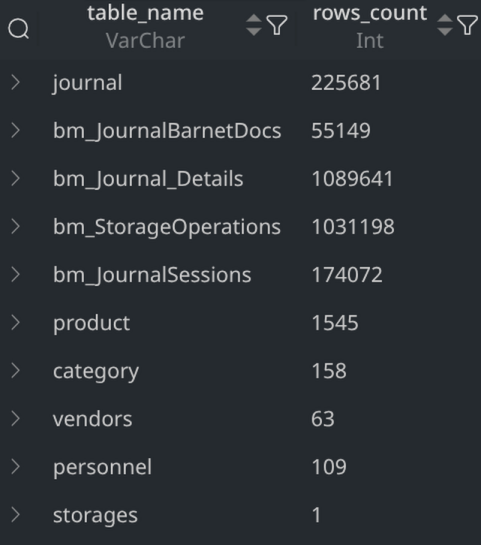

## 1. Анализ закупки продукции

Нужны `bm_JournalBarnetDocs` (только `DocumentTypeID = 4`), `bm_StorageOperations` (только `OperationID = 1`), `vendors` и `product`. Для расшифровки кодов еще пригодятся `bm_JournalTypeDocuments`, `bm_JournalType`, `bm_StorageOperationsType`, `bm_Companies`, `bm_ShiftsOperations` и `storages`.

### bm_JournalTypeDocuments - виды документов

| Колонка | Назначение | Пример | Связь |
|---|---|---|---|
| ID | номер вида | 4 | PK |
| Description | название | Поступление продуктов | - |
| JournalID | журнал | 3 | bm_JournalType.ID |
| IsParent | признак группы | 0 | - |

### bm_JournalType - журналы

| Колонка | Назначение | Пример | Связь |
|---|---|---|---|
| ID | номер журнала | 3 | PK |
| JournalName | название | Складской учет | - |

### bm_StorageOperationsType - виды складских операций

| Колонка | Назначение | Пример | Связь |
|---|---|---|---|
| ID | номер вида | 1 | PK |
| Description | название | Поступление | - |
| Factor | знак операции | 1, -1 | - |

### bm_Companies - организации

| Колонка | Назначение | Пример  | Связь |
|---|---|---|---|
| ID | номер | 6 | PK |
| CompanyName | полное название | ИП Лукьянова Анастасия Игоревна | - |
| ShortName | краткое название | Пиzzбург | - |
| INN | ИНН | 380122679974 | - |
| IsUse | используется | 1 | - |

### bm_ShiftsOperations - смены

| Колонка | Назначение | Пример | Связь |
|---|---|---|---|
| ID | номер смены | 65 | PK |
| ShiftNumber | номер смены в дне | 1 | - |
| Amount | сумма | 0.00 | - |
| PersonalID | сотрудник | 0 | - |
| CompanyID | организация | 6 | - |

В таблице одна запись: `ID = 65`, создана 2015-07-14, `PersonalID = 0`

По цифрам: 3175 документов и 11358 строк, около 19.6 млн руб. Закупка - это `DocumentTypeID = 4` в шапке и `OperationID = 1` в строках. Сумма по шапке с суммой строк сходится. На уровне строк есть одно явное расхождение - 702.30 руб, остальное - округления (запрос 1.9).

### ER-диаграмма

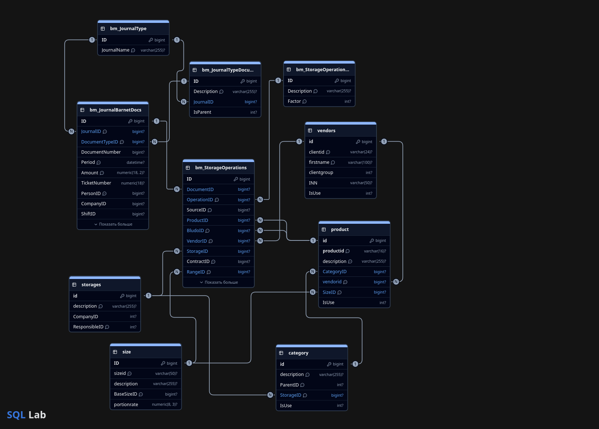

### Результаты выборок

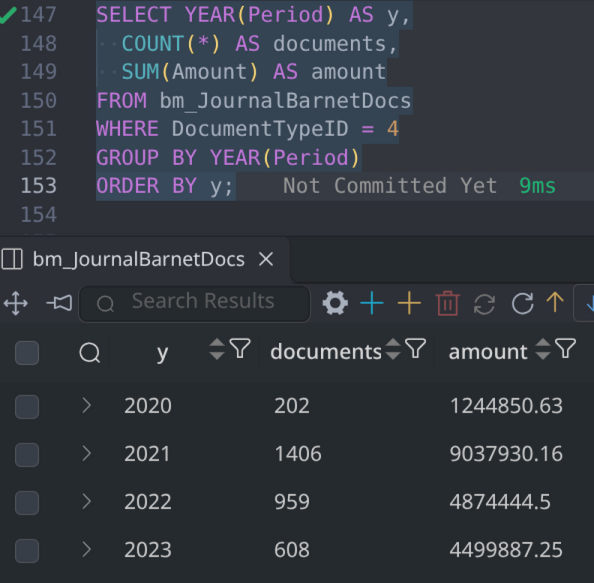

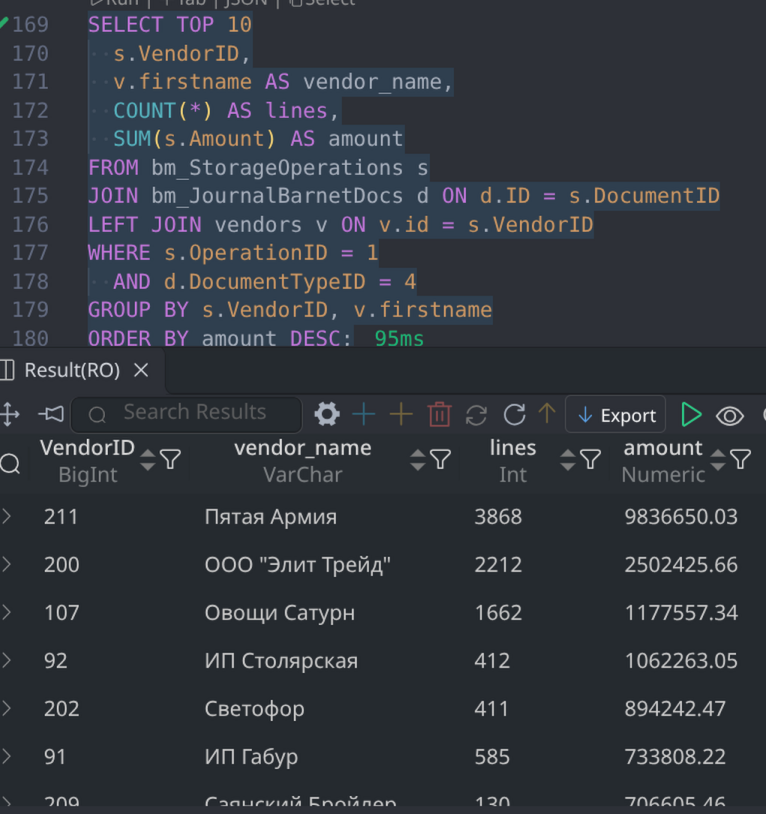

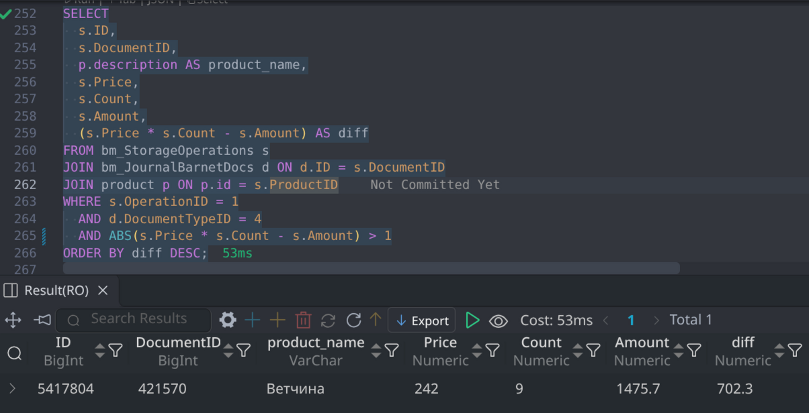

## 2. Анализ продажи товара

Нужны `journal` (только `transtype = 101`), `bm_Journal_Details`, `product` и `category`. Остальное (`transtype`, `paymenttype`, `bm_JournalBarnetDocs` с `DocumentTypeID = 6`, `personnel`, `size`, `bm_classifierSizes`, `storages`) нужно для расшифровки.

`bm_JournalBarnetDocs`, `product`, `category` и `personnel` в общих таблицах.

### journal - журнал транзакций

| Колонка | Назначение | Пример | Связь |
|---|---|---|---|
| transnumber | номер строки | 1951181 | PK |
| transtype | тип транзакции | 101 (продажа), 501 (итог чека) | transtype.transtypeid |
| receiptn | номер чека | 50672281 | - |
| dater | дата и время | 2023-12-06 13:58:26 | - |
| id | артикул продукта | 7239833 | product.productid (без FK) |
| description | название продукта | Соус Барбекю | - |
| categoryid | категория | 178 | category.id (без FK) |
| quantity | количество | 1.000 | - |
| price | цена | 50.00 | - |
| amount | сумма | 50.00 | - |
| discountamount | сумма скидки | 0.00 | - |
| flagrefund | возврат | 0, 1 | - |
| loginid | логин кассира | 906 | personnel.personid (без FK) |
| customerid | клиент | NULL | - |
| vendorid | поставщик | NULL | vendors.id (без FK) |

`transtype = 101` - строки товаров, `501` - итог чека.

### bm_Journal_Details - состав проданных блюд

| Колонка | Назначение | Пример | Связь |
|---|---|---|---|
| ID | номер строки | 225297748 | PK |
| SourceID | строка journal | 1950990 | journal.transnumber |
| ProductID | ингредиент | 7650 | product.id |
| BludoID | блюдо | 4822 | product.id |
| RangeID | единица | 42 (кг) | size.ID |
| sBrutto | вес брутто, г | 80.000 | - |
| Count | количество, кг | 0.0800 | - |
| TicketNumber | номер чека | 52169561 | - |
| SizeID | размер | 163 (г) | bm_classifierSizes.ID (без FK) |
| StorageID | склад | 41 | storages.id (без FK) |

### transtype - типы транзакций

| Колонка | Назначение | Пример | Связь |
|---|---|---|---|
| transtypeid | номер типа | 101 | PK |
| description | название | PLU Sales | - |
| transgroupid | группа | 1 | - |
| PreviewGroupType | группа для отчетов | POS | - |

### paymenttype - способы оплаты

| Колонка | Назначение | Пример | Связь |
|---|---|---|---|
| paymenttypeid | номер способа | 211 (наличные), 216 (безнал) | PK |
| description | название | Наличные | - |
| paymentflag | признак | 1 | - |
| currencyid | валюта | NULL | - |
| simplepayment | простой способ | 1 | - |

### size - единицы измерения

| Колонка | Назначение | Пример | Связь |
|---|---|---|---|
| ID | номер | 42 (кг) | PK |
| sizeid | код единицы | кг | - |
| description | название | кг | - |
| BaseSizeID |  базовая единица | 163 (г) | bm_classifierSizes.ID (без FK) |
| portionrate | коэффициент | 1000.000 | - |
| IsUse | используется | 1 | - |

### bm_classifierSizes - единицы измерения

| Колонка | Назначение | Пример | Связь |
|---|---|---|---|
| ID | номер единицы | 163 (грамм) | PK |
| GroupID | группа единиц | 4 (единицы массы) | - |
| ShortName | краткое обозначение | г | - |
| Description | название | Грамм | - |

Выручка - 42.3 млн. Возвратов 1361 строка (`flagrefund = 1`). Все продажи записаны на `loginid = 906` - это служебная запись "Доставка", поэтому по журналу не видно, кто именно продал. 15483 строки - служебные позиции без техкарты (время доставки, бонусы, подарки), поэтому их нет в `bm_Journal_Details`. Итог по `501` больше `101` на 562.8 тыс. руб.: 1978 чеков имеют `501`, но не имеют `101`, и их сумма 570.9 тыс. руб. совпадает с `transtype = 111` - это списания по себестоимости.

### ER-диаграмма

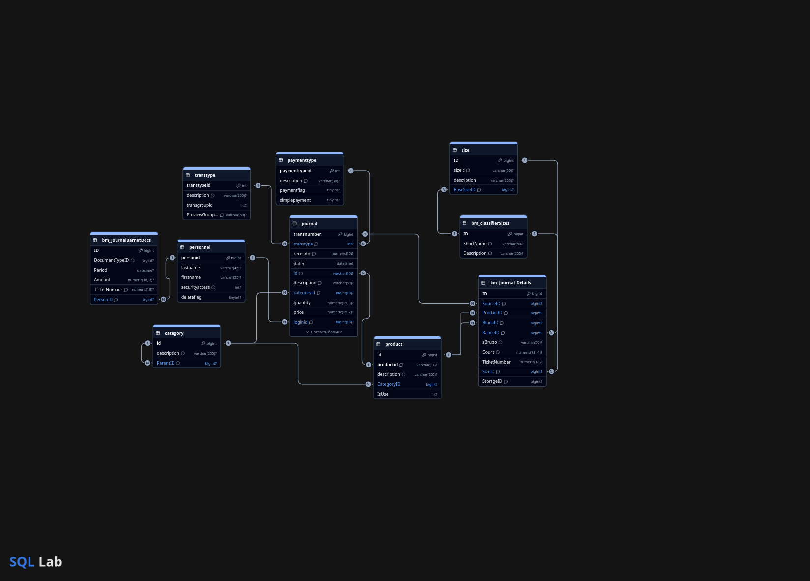

### Результаты выборок

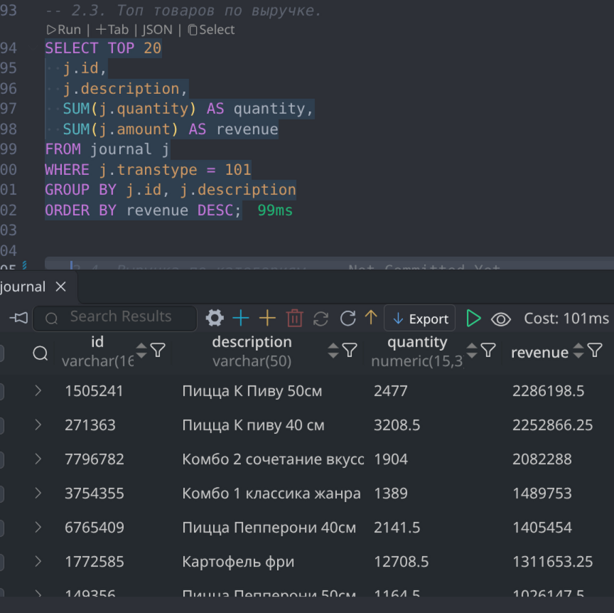

## 3. Анализ взаимоотношений с поставщиками

`vendors`, `vendorgroup`, `bm_StorageOperations` (по `VendorID`) и `product`. Еще `pricelist`, `pricegroup`, `bm_JournalBarnetDocs`, `bm_Contracts` и `bm_StorageOperationsType`.

`vendors`, `product`, `bm_StorageOperations` и `bm_JournalBarnetDocs` в общих таблицах.

### vendorgroup - группы контрагентов

| Колонка | Назначение | Пример | Связь |
|---|---|---|---|
| vendorgroupid | номер группы | 31 | PK |
| description | название | Поставщики | - |
| flag  | признак | 0 | - |

### pricelist - прайс-лист

| Колонка | Назначение | Пример | Связь |
|---|---|---|---|
| id | номер строки | 234802 | PK |
| DocumentID | документ установки цен | 465980 | bm_JournalBarnetDocs.ID |
| productid | продукт | 4377 | product.id |
| groupid | вид цены | 3 (средняя цена) | pricegroup.pricegroupid |
| vendorid | поставщик | NULL | vendors.id (без FK) |
| description | описание | - | - |
| basecost | цена | 0.00 | - |
| dateeff | дата действия | NULL | - |

### pricegroup - виды цен

| Колонка | Назначение | Пример | Связь |
|---|---|---|---|
| pricegroupid | номер вида | 1 (закупочная), 2 (розничная), 3 (средняя) | PK |
| description | название | Розничная | - |

### bm_Contracts - договоры

Таблица пустая: 0 строк, не используется.

В справочнике 63 поставщика, 59 из них в группе "Поставщики". В закупках реально встречается 21 поставщик. Больше половины суммы - у "Пятой Армии" (9.84 млн из 19.66 млн). ИНН заполнен только у 5 из 63, телефоны, контакты и email - ни у кого. `product.vendorid` почти везде 0 (1544 из 1545), единственный заполненный - бананы у "Овощи Сатурн". В `pricelist` поле `vendorid` пустое у всех 24797 строк, а закупочной группы `groupid = 1` там нет вообще.

### ER-диаграмма

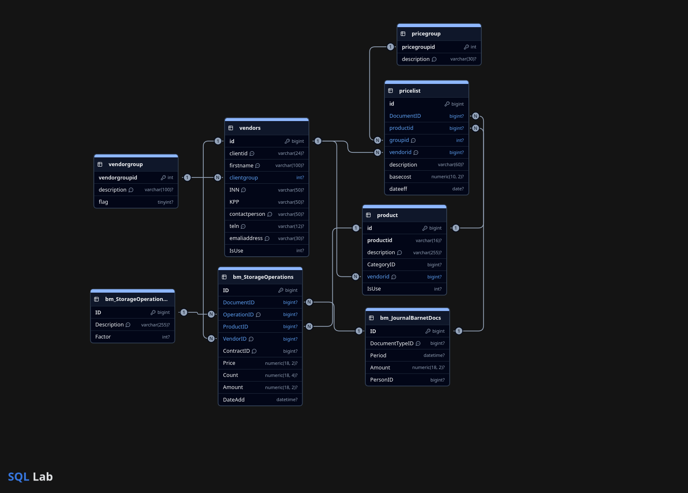

### Результаты выборок

Запрос 3.3 считает те же суммы по поставщикам, что и 1.3, но дополнительно выводит количество документов и не ограничивается топ-10. Ниже приведён результат запроса 1.3.

## 4. Анализ работы персонала

Нужны `personnel`, `securityaccess`, `bm_JournalBarnetDocs` (по `PersonID`), `journal` (по `loginid`), `bm_JournalSessions` и `bm_PersonnelSecurity`, `bm_SecurityObjects`, `storages` и `bm_ShiftsOperations`.

`personnel`, `bm_JournalBarnetDocs`, `journal` и `bm_ShiftsOperations` выше.

### securityaccess - роли

| Колонка | Назначение | Пример | Связь |
|---|---|---|---|
| securityaccessid | номер роли | 9 | personnel.securityaccess (без FK) |
| description |  название | Special Access | - |

PK в таблице нет.

В справочнике 4 роли: 2 Clerk, 3 Manager/Adm, 4 Bartender, 9 Special Access. Роли 1 нет, хотя она стоит у 102 сотрудников.

### bm_JournalSessions - журнал работы программы

| Колонка | Назначение | Пример | Связь |
|---|---|---|---|
| ID | номер записи | 174072 | PK |
| Type | тип события | barnetbc.ru | - |
| Message | сообщение | Ошибка SSL/TLS | - |
| IsError | ошибка | 1 | - |
| DateAdd | дата и время | 2023-12-06 14:18:08 | - |
| UserAdd | пользователь БД | userdb | - |
| PersonID | сотрудник | 897 | personnel.personid (без FK) |

### bm_PersonnelSecurity - права на объекты

| Колонка | Назначение | Пример | Связь |
|---|---|---|---|
| ID | номер записи | 1397 | PK |
| PersonID | сотрудник | 906 | personnel.personid (без FK) |
| ObjectID | объект программы | 36 | bm_SecurityObjects.ID |
| IsUse | разрешено | 1 | - |

### bm_SecurityObjects - объекты программы

| Колонка | Назначение | Пример | Связь |
|---|---|---|---|
| ID | номер объекта | 1 | PK |
| SecurityGroup | группа | Прочее | - |
| ObjectName | системное имя | dlgProperties | - |
| Description | описание | Форма настроек | - |

Всего 109 записей: 102 с ролью 1, 2 с ролью 3, 5 с ролью 9. Роль 1 в `securityaccess` отсутствует У всех 109 `deleteflag = 1`, а записи 897, 904, 905 и 906 - службные (`Администратор Barnet`, `Касса 1`, `Касса 2`, `Доставка`). Продажи все на `loginid = 906`, поэтому по журналу не видно, кто продал. `bm_ShiftsOperations` содержит одну запись 2015 года. В `bm_JournalSessions` 75248 ошибок, из них 74374 - таймауты загрузки журнала с пустым `Type`.

### ER-диаграмма

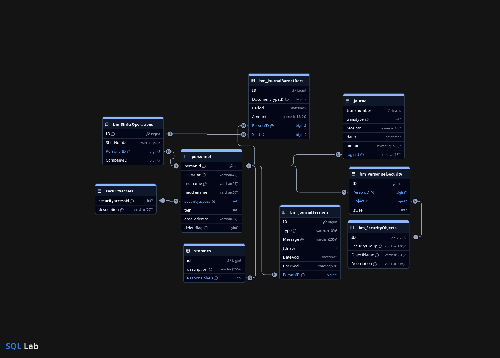

### Результаты выборок

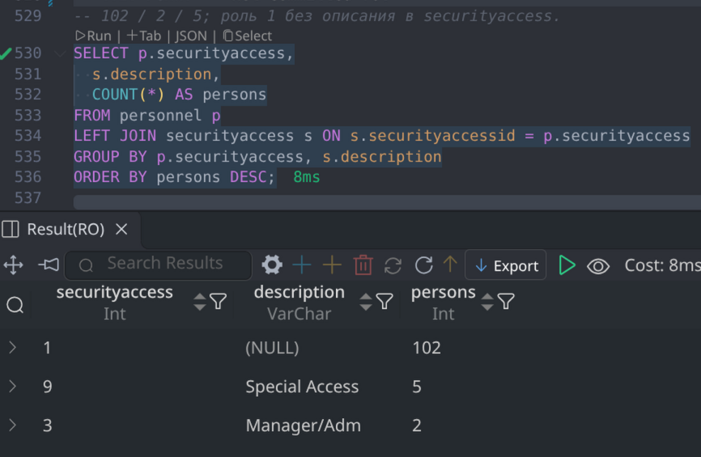

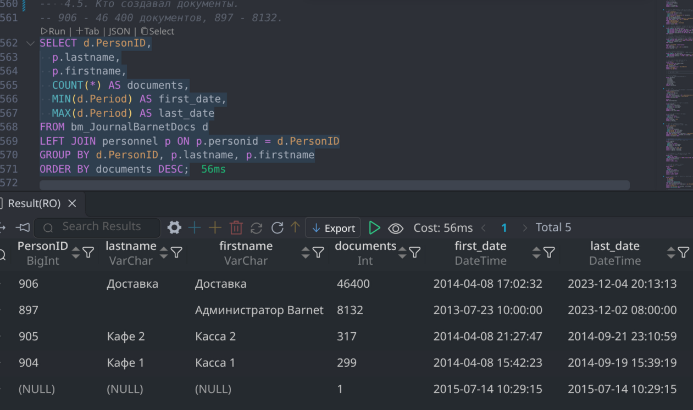

## 5. Анализ остатков

`bm_StorageOperations`, `bm_StorageOperationsType`, `product`, `storages` и `bm_JournalBarnetDocs`, `bm_ReasonDebit`, `bm_StorageOperations_Table`, `stockperiod`, `category` и `size`.

`bm_StorageOperations`, `bm_StorageOperationsType`, `product`, `category` и `bm_JournalBarnetDocs` выше.

### storages - склады

| Колонка | Назначение | Пример | Связь |
|---|---|---|---|
| id | номер склада | 41 | PK |
| description | название | Склад | - |
| CompanyID | организация | 6 | bm_Companies.ID (без FK) |
| Address | адрес | NULL | - |
| ResponsibleID | ответственный | 897 | personnel.personid (без FK) |
| DepartmentID | подразделение | NULL | - |

### bm_ReasonDebit - причины списания

| Колонка | Назначение | Пример | Связь |
|---|---|---|---|
| ID | номер причины | 1 | PK |
| ParentID | родительская причина | 0, 7 | bm_ReasonDebit.ID (без FK) |
| Description | название | Порча продукта | - |
| IsUse | используется | 1 | - |

### bm_StorageOperations_Table - вторая складская таблица

Очень похожа на `bm_StorageOperations`. Нет `VendorID`, `BatchID` и `Period`. Проверка по `DocumentID + ProductID + Count + Amount` дает 29914 совпадений из 30801 - таблица почти дублирует списания (запрос 5.7).

| Колонка | Назначение | Пример | Связь |
|---|---|---|---|
| ID | номер строки | 165000 | PK |
| DocumentID | документ | 465974 | bm_JournalBarnetDocs.ID |
| OperationID | вид операции | 2 (списание) | bm_StorageOperationsType.ID |
| SourceID | строка journal | 1950928 | journal.transnumber (без FK) |
| ProductID | продукт | 4382  | product.id |
| BludoID | блюдо | 4529 | product.id (без FK) |
| StorageID | склад | 41 | storages.id |
| Price | цена | 275.30 | - |
| Count | количество | -0.0500 | - |
| Amount | сумма | -13.7700 | - |
| ReasonID | причина | 122 | bm_ReasonDebit.ID (без FK) |

### stockperiod - старые остатки

| Колонка | Назначение | Пример | Связь |
|---|---|---|---|
| id | номер строки | 1 | PK |
| storeid | склад | 1 | - |
| productid | продукт | NULL | - |
| price | цена | 2.30 | - |
| quantityopen | остаток на начало | 0.000 | - |
| quantityin | приход | 10000.000 | - |
| quantityout | расход | 14999.000 | - |
| quantityclose | остаток на конец | 0.000 | - |
| datebeginperiod | начало периода | 2015-02-17 | - |

Если группировать по `ProductID + RangeID`, получается 485 групп, из них 308 отрицательных, продуктов хотя бы с одной отрицательной группой - 253. По деньгам приход 20.0 млн, списание -86.1 млн, итог -66.1 млн. Возможно не были заполнены начальные. Инвентаризация (`DocumentTypeID = 8`) - один документ с нулевым количеством.

### ER-диаграмма

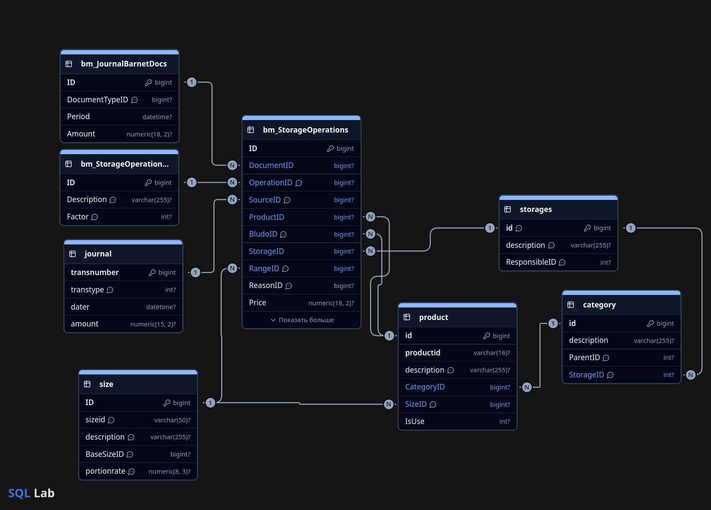

### Результаты выборок

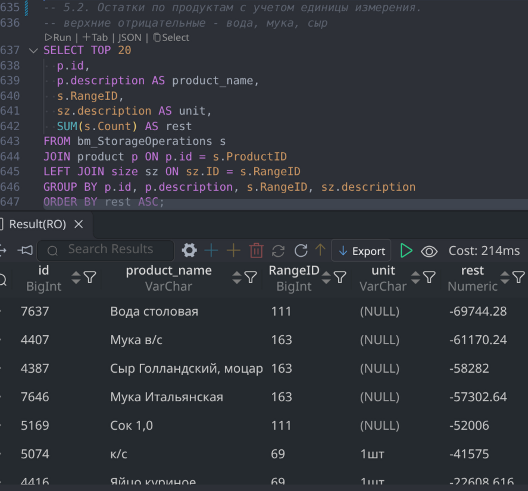
